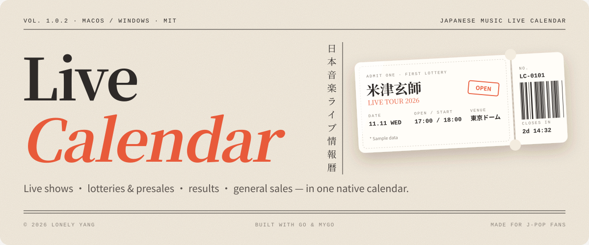
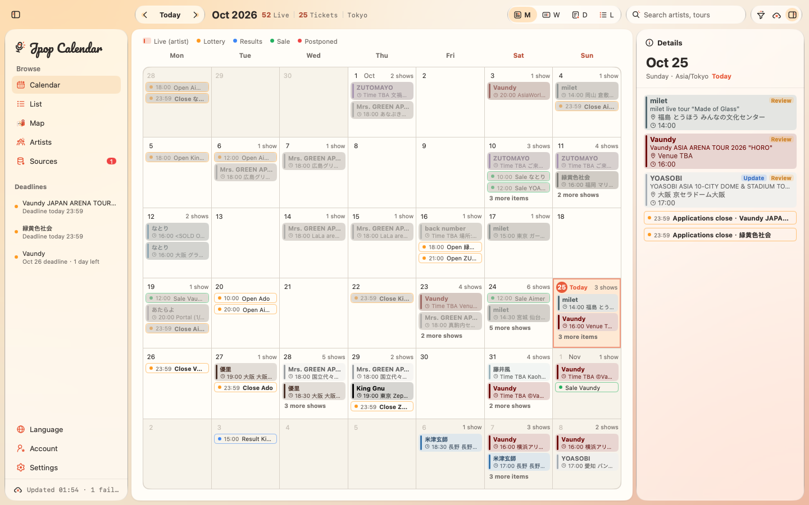
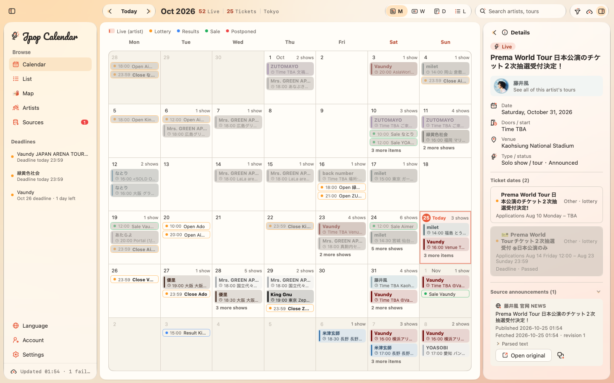
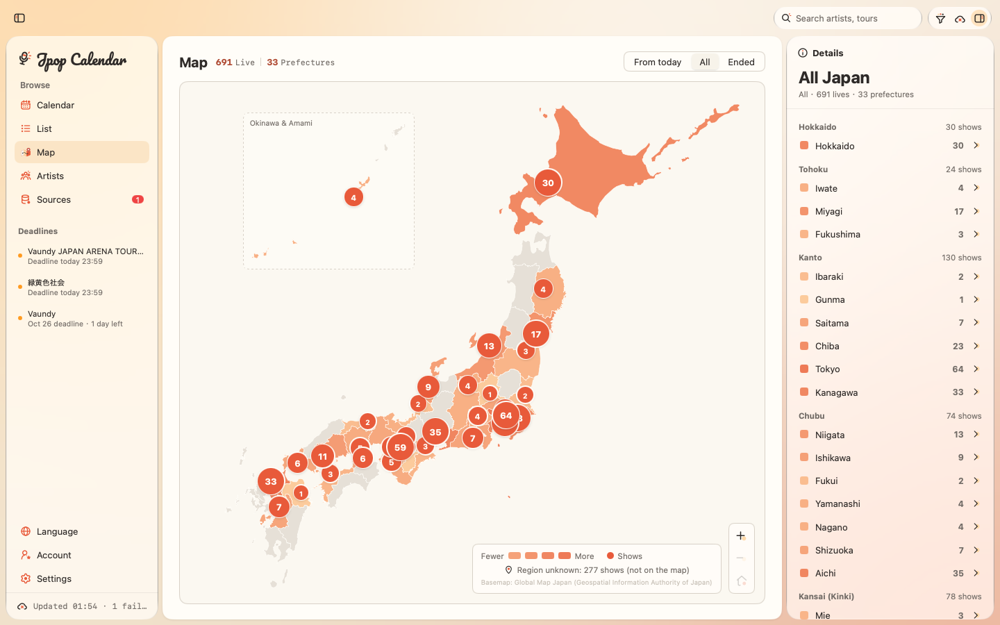
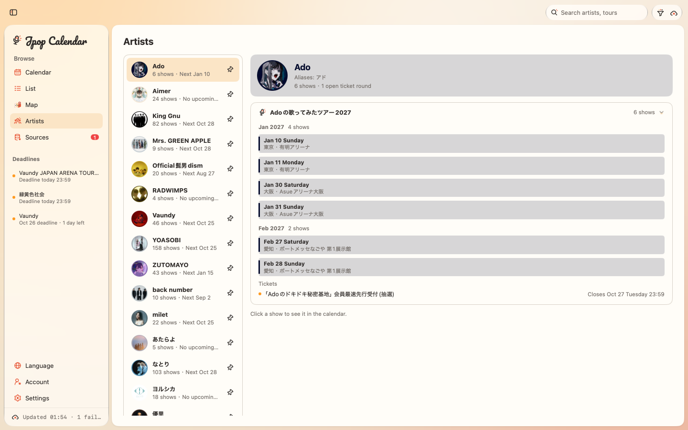
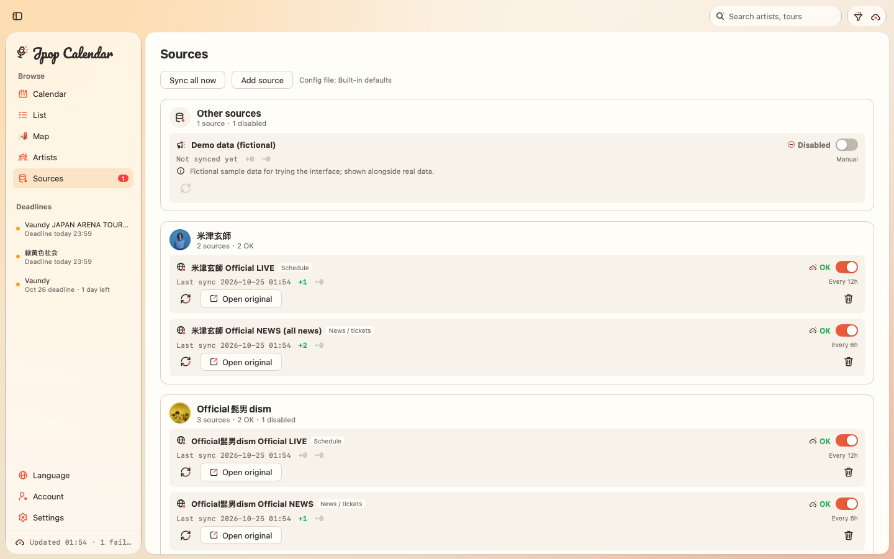

<p align="center">
  
</p>

<p align="center">
  <a href="#changelog"></a>
  <a href="LICENSE"></a>
  <a href="https://go.dev"></a>
  <a href="https://github.com/egoist/mygo"></a>
  <a href="#getting-started"></a>
  <a href="#getting-started"></a>
  <a href="https://github.com/Lonely0710/jpop-live-calendar/commits"></a>
  <a href="https://github.com/Lonely0710/jpop-live-calendar"></a>
  <a href="#data-principles"></a>
  <a href="#spotlight-icons"></a>
  <a href="https://github.com/Lonely0710/jpop-live-calendar/pulls"></a>
</p>

<p align="center">
  <a href="README.md">简体中文</a> · <a href="README.ja.md">日本語</a> · <b>English</b>
</p>

Live Calendar is a native desktop app for macOS and Windows that turns official announcements of Japanese music live shows, ticket lotteries and presales, result announcements, and general sales into a single calendar.



## Features

<table>
<tr>
<td width="50%" valign="top">&nbsp;&nbsp;<code>01</code>&nbsp;<b>Calendar</b><br><sub>Month, week, day, and list views with search and filters for type, source, region, and date range.</sub></td>
<td width="50%" valign="top">&nbsp;&nbsp;<code>02</code>&nbsp;<b>Ticket milestones</b><br><sub>Each presale round, result announcement, and general sale appears separately, with a countdown and the official link.</sub></td>
</tr>
<tr>
<td width="50%" valign="top">&nbsp;&nbsp;<code>03</code>&nbsp;<b>Map</b><br><sub>Live shows counted by prefecture; select a region to list its shows on the right.</sub></td>
<td width="50%" valign="top">&nbsp;&nbsp;<code>04</code>&nbsp;<b>Artists</b><br><sub>Shows grouped by tour and month, with pinning, tour filters, and an option to hide finished tours.</sub></td>
</tr>
<tr>
<td width="50%" valign="top">&nbsp;&nbsp;<code>05</code>&nbsp;<b>Provenance</b><br><sub>Source announcement, publish time, fetch time, revision, and the text used for parsing.</sub></td>
<td width="50%" valign="top">&nbsp;&nbsp;<code>06</code>&nbsp;<b>Change history</b><br><sub>Postponements, cancellations, and deadline changes are recorded instead of overwritten.</sub></td>
</tr>
<tr>
<td width="50%" valign="top">&nbsp;&nbsp;<code>07</code>&nbsp;<b>Background sync</b><br><sub>Stays in the menu bar (macOS) / system tray (Windows) and notifies you 3 days before a lottery deadline.</sub></td>
<td width="50%" valign="top">&nbsp;&nbsp;<code>08</code>&nbsp;<b>Local snapshot</b><br><sub>Shows the last results at launch, then refreshes in the background; one failing source never blocks the others.</sub></td>
</tr>
<tr>
<td width="50%" valign="top">&nbsp;&nbsp;<code>09</code>&nbsp;<b>Interface language</b><br><sub>Follow the system, or choose Simplified Chinese, Japanese, or English; UI text, parser notes, and change logs switch together.</sub></td>
</tr>
</table>

<p align="center">
  
</p>

<p align="center">
  
</p>

<p align="center"><sub>Both images above use sample data.</sub></p>

## Screenshots

<table width="100%">
  <tr>
    <td width="50%" align="center" valign="top"><b><small>FIG. 1</small> Inspector</b><br></td>
    <td width="50%" align="center" valign="top"><b><small>FIG. 2</small> Map</b><br></td>
  </tr>
  <tr>
    <td width="50%" align="center" valign="top"><b><small>FIG. 3</small> Artists</b><br></td>
    <td width="50%" align="center" valign="top"><b><small>FIG. 4</small> Sources</b><br></td>
  </tr>
</table>

## Data principles

- **Public information only**: data comes from official sites, RSS feeds, and Sony Music's public JSON. No logins, no member pages, no scraping of ticketing platforms; ticket links are taken only from official announcements.
- **Polite crawling**: respects robots.txt (RFC 9309) and requests each host serially with at least 1 second between requests.
- **No guessing**: unannounced times or venues are shown as "Time TBA" or "Venue TBA", and uncertain parses are marked "Needs review".

Ships with 21 followed artists and 34 enabled sources.

## Getting started

| Requirement | Version |
| --- | --- |
| Go | 1.27+ |
| macOS | 13+ (Apple Silicon / Intel) |
| Windows | 10 / 11 x64; can be cross-compiled from macOS / Linux |
| Xcode Command Line Tools | for packaging on macOS |
| NSIS | optional, for the Windows installer |

```bash
go mod download
go tool mygo dev                  # dev mode, restarts on save
go test ./...                     # tests
go vet ./... && go tool mygo vet .

scripts/package.sh darwin/arm64   # → build/jpop-live-calendar-darwin-arm64-<version>.dmg
scripts/package.sh windows/amd64  # → build/jpop-live-calendar-windows-amd64-<version>.zip
```

On Windows, unzip the package and run `Live Calendar.exe`; keep the resource files next to it.

## Keyboard shortcuts

| Action | macOS | Windows |
| --- | --- | --- |
| Previous / next page | ⌘← / ⌘→ | Ctrl+← / Ctrl+→ |
| Go to today | ⌘T | Ctrl+T |
| Month / week / day / list | ⌘1 – ⌘4 | Ctrl+1 – Ctrl+4 |
| Sync now | ⌘R | Ctrl+R |
| Toggle sidebar | ⌃⌘S | Ctrl+Shift+S |
| Toggle inspector | ⌥⌘I | Ctrl+Alt+I |
| Back / clear search | Esc | Esc |

With the map focused: ←/→ switch regions, +/− zoom, 0 shows all of Japan. You can also drag to pan, scroll to zoom, and double-click to zoom in.

## Configuration

Sources and artists are defined in `sources.yaml`, read in this order:

1. The `LIVE_CALENDAR_CONFIG` environment variable
2. The user directory: `~/Library/Application Support/Live Calendar/` on macOS, `%AppData%\Live Calendar\` on Windows
3. `config/sources.yaml` in the current directory
4. The default configuration built into the app

```yaml
sources:
  - id: my-band-live
    name: My Band official LIVE
    kind: website        # demo | rss | website | api
    layer: live          # live: schedule page; news: announcement page
    url: https://example.com/live/
    interval: 12h        # 0 = manual sync only
    artist: My Band      # optional: attribute the page to this artist

artists:
  - name: ステラリウム
    aliases: [Stellarium]
    color: "#3975AB"     # optional: theme color
```

See the comments in [`config/sources.yaml`](config/sources.yaml) for all fields (`article` filters, `follow` / `feature` patterns, avatar settings, and more). `name` / `note` are written in Chinese; add `name_ja` / `name_en` (and `note_ja` / `note_en`) to show the source in the language the interface shows. Sources can also be added, disabled, or removed on the Sources page; comments are preserved when the file is written back.

### Avatars

Avatars are **a photo first, a cover last**: Deezer (`api.deezer.com`, the artist's photo) → QQ Music (`c.y.qq.com`, the artist's photo) → iTunes (`itunes.apple.com`, an album cover at 600 px). All three are keyless and matched exactly by name and aliases.

Why the last one is a cover: in Apple's public Search / Lookup API, `entity=musicArtist` returns only `artistId`, `artistLinkUrl` and the genre — **there is no image field at all**; only albums and songs carry `artworkUrl100`. The artist images on Apple Music's website come from an internal, token-gated endpoint. So artist photos can only come from Deezer or QQ Music.

`api.deezer.com` is not reachable from mainland China, so what you actually get there is QQ Music's photo (Tencent does not document that endpoint; write `avatars: itunes` if that bothers you). `avatars:` takes `deezer` (default, photo first), `qq` (skip Deezer), `itunes` (covers only) and `off`.

## Project layout

```
main.go              entry point: window, menu bar / tray, background sync
config/              loading, validating, and writing sources.yaml
internal/
  sources/ crawler/  source adapters and the robots.txt-aware crawler
  parser/ normalize/ parsing and normalizing Japanese announcements
  dedup/ catalog/    merging, change history, in-memory snapshot
  views/ theme/      UI and theme
  avatar/ cache/     artist avatars, local JSON snapshot
  geo/               embedded prefecture map data
packages/spotlight-icons/  icon library (63 SVGs)
scripts/package.sh   packaging script
```

## Spotlight Icons

The project's own icon set: 63 SVGs on a 24×24 grid in 6 groups, with a 1.75–2 px stroke and only the three Spotlight theme colors. It is an ordinary package in the main module — just import it.

<p align="center">
  
</p>

```go
import (
	icons "jpop-live-calendar/packages/spotlight-icons"
	"jpop-live-calendar/packages/spotlight-icons/mygoicons"
)

mygoicons.Image(c, icons.Calendar, 18) // keep the original colors (Ink Charcoal + Live Coral)
mygoicons.Mono(c, icons.Calendar, 18)  // monochrome, follows the text color
```

See [packages/spotlight-icons](packages/spotlight-icons/README.md) for adding or replacing icons and regenerating constants.

## Known limitations

- Parsing rules cover common phrasings in Japanese announcements only; the original text is authoritative.
- The map is accurate to the prefecture level only: shows are placed at the prefectural capital, not at the actual venue.
- Tray, notifications, and title bar on Windows have not been fully verified on real hardware.
- The interface switches between Simplified Chinese, Japanese, and English. Artist names, tours, venues, announcement text, and names in `sources.yaml` stay in their original language.

## Roadmap

- Better parsing of ticket rounds, e.g. announcements that put dates on the line after "●エントリー期間".
- Edit `article` filters and `follow` rules directly on the Sources page.
- Optional Chinese and Japanese public holidays in the calendar.

## Changelog

- **1.1.0** (2026-10-25): UI in Simplified Chinese, Japanese and English, with new installers and website.
- **1.0.2** (2026-10-23): added the map page with live counts by prefecture.
- **1.0.1** (2026-10-22): Windows support; artist page grouped by tour; several parsing fixes; icon library expanded to 63 icons.
- **1.0.0**: menu bar mode, deadline reminders, adding sources in the app, avatar cache.
- **0.7.0**: local JSON snapshot.
- **0.6.0**: sources split into schedule and announcement layers; Sony Music public JSON.
- **0.5.0**: switched to MyGo native controls; collapsible sidebar.
- **0.4.0**: Liquid Glass UI; artist avatars and theme colors.

## License and credits

Code is released under the [MIT](LICENSE) license. Commercial use of the map data must be reported to GSI.

<table align="center">
<tr><td align="right"><sub>Author</sub></td><td></td><td><a href="https://github.com/Lonely0710"><b>Lonely Yang</b></a></td></tr>
<tr><td align="right"><sub>Native UI framework</sub></td><td></td><td><a href="https://github.com/egoist/mygo"><b>MyGo</b></a></td></tr>
<tr><td align="right"><sub>Language</sub></td><td></td><td><a href="https://go.dev"><b>Go</b></a></td></tr>
<tr><td align="right"><sub>Map data</sub></td><td></td><td><a href="https://www.gsi.go.jp/kankyochiri/gm_jpn.html"><b>Global Map Japan (GSI)</b></a></td></tr>
<tr><td align="right"><sub>GeoJSON conversion</sub></td><td></td><td><a href="https://github.com/dataofjapan/land"><b>dataofjapan/land</b></a></td></tr>
<tr><td align="right"><sub>Public JSON source</sub></td><td></td><td><a href="https://www.sonymusic.co.jp"><b>Sony Music</b></a></td></tr>
<tr><td align="right"><sub>Artist avatars</sub></td><td></td><td><a href="https://www.deezer.com"><b>Deezer API</b></a></td></tr>
<tr><td align="right"><sub>Hosting</sub></td><td></td><td><a href="https://github.com"><b>GitHub</b></a></td></tr>
</table>
