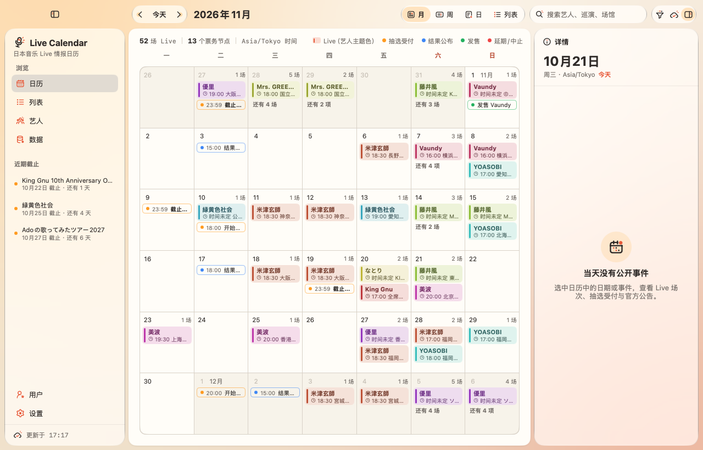
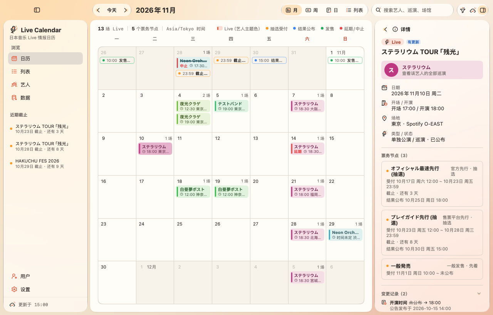
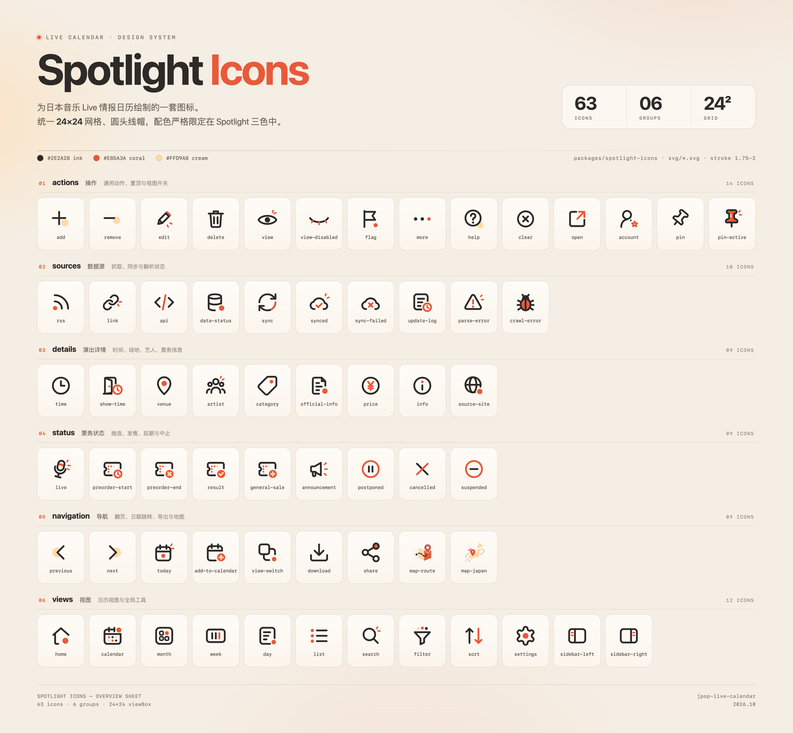

# Live Calendar · 日本音楽 Live 情報カレンダー

<p align="center">
  <a href="#更新履歴"></a>
  <a href="LICENSE"></a>
  <a href="https://github.com/egoist/mygo"></a>
</p>

<p align="center">
  <a href="README.md">简体中文</a> · <b>日本語</b> · <a href="README.en.md">English</a>
</p>

<p align="center">
  
</p>

macOS / Windows ネイティブデスクトップアプリ（**MyGo Native UI + Go**）。日本音楽の Live、抽選・先行受付、結果発表、一般発売などの**公開情報**をカレンダーに整理します。データベースなし、ログインなし。



## 機能

- **4 つのビュー**：月 / 週 / 日 / リスト。⌘← / ⌘→ でページを移動、⌘T で今日へ。Live はカラーバー付きの塗りつぶしバー、受付開始・締切、結果発表、一般発売はドット付きの枠線ピルで表示します。締切は太字、延期・中止は赤。
- **チケット日程が一目でわかる**：同じ公演の各受付ラウンド、結果発表、一般発売を独立したノードとしてカレンダーに表示し、それぞれにカウントダウンと申込 / 購入リンクを持たせます。
- **すべて追跡できる**：各公演・チケットノードから元の告知へ戻れます。公開日時、取得日時、リビジョン、解析に使ったテキストを確認でき、原文も開けます。
- **公開情報だけを取得**：既定で 21 組のアーティスト、34 件の公式 / 公開ソース（公式サイト、RSS、Sony Music の公開 JSON）。ログインせず、会員ページやチケット販売サイトを直接クロールしません。robots.txt を守り、同一サイトへのリクエストは直列で 1 秒以上空けます。
- **欠けた項目は推測しない**：未発表の時間は「時間未発表」、会場は「会場未発表」、不確かな推測は「要確認」と表示します。延期・中止・締切の変更は黙って上書きせず、変更履歴に残します。
- **ローカルスナップショット + バックグラウンド同期**：公開された告知とアバターは `cache.json` / `avatars.json` にキャッシュし、再起動時は前回の結果を先に表示します。1 つのデータソースが失敗してもその記録だけに留まり、他のソースや既存データを消しません。
- **常駐とリマインダー**：ウィンドウを閉じても非表示になるだけで、メニューバー（macOS）/ システムトレイ（Windows）で同期を継続します。抽選受付の締切 3 日前に 1 回通知し（`notified.json`）、締切が延長されたら新しい時刻で再度通知します。
- **読み取り専用・アカウントなし**：ログイン、お気に入り、個人の購入状態、クラウド同期はありません。サイドバー下部のアカウント入口はプレースホルダーです。

| 詳細とチケット日程 | データソース |
| --- | --- |
|  |  |

## はじめに

### 動作環境

| 項目 | バージョン |
| --- | --- |
| macOS | 13 以上（Apple Silicon / Intel のどちらも可） |
| Windows | 10 / 11 x64（macOS / Linux からのクロスコンパイル可） |
| Go | **1.27 以上**（MyGo v0.5.5 は go 1.27 が必要） |
| Xcode Command Line Tools | macOS で `.app` / `.dmg` をパッケージする場合に必要：`xcode-select --install` |
| NSIS（任意） | Windows のインストーラーを作る場合に `makensis` が必要。なくてもポータブル zip は生成されます |

```bash
brew install go        # または https://go.dev/dl/ からインストール
go version             # go1.27.x 以上が表示されること
```

### 起動

```bash
go mod download        # 初回：MyGo などの依存関係を取得
go tool mygo dev       # ビルドしてネイティブウィンドウを開く。保存すると自動で再起動
go run .               # または直接実行
```

### テスト

```bash
go test ./...
go vet ./... && go tool mygo vet .
```

### パッケージ

`scripts/package.sh` は `mygo.json` からバージョンを読み取り、MyGo でビルドして、生成物を `jpop-live-calendar-{プラットフォーム}-{バージョン}` と命名します：

```bash
scripts/package.sh windows/amd64   # → build/jpop-live-calendar-windows-amd64-1.0.1.zip
scripts/package.sh darwin/arm64    # → build/jpop-live-calendar-darwin-arm64-1.0.1.dmg（または .zip）
scripts/package.sh darwin/universal
```

Windows の zip を展開すると、同名のフォルダーができます。中の `Live Calendar.exe` をダブルクリックして実行してください。exe だけを取り出さず、隣のリソースファイルも残してください。NSIS があれば `...-setup.exe` も生成されます。`go tool mygo build -platform windows/amd64` を直接使うこともでき、生成物は `build/windows-amd64/` に置かれます（ファイル名は MyGo の既定形式）。

## ショートカット

macOS は ⌘、Windows は Ctrl を使用します：

| 機能 | macOS | Windows |
| --- | --- | --- |
| 前 / 次の月（週、日） | ⌘← / ⌘→ | Ctrl+← / Ctrl+→ |
| 今日へ戻る | ⌘T | Ctrl+T |
| 月 / 週 / 日 / リスト表示 | ⌘1 – ⌘4 | Ctrl+1 – Ctrl+4 |
| 有効なデータソースをすべて今すぐ同期 | ⌘R | Ctrl+R |
| 詳細パネルからイベントを閉じて当日の一覧へ | Esc | Esc |
| 左サイドバーの表示 / 非表示 | ⌃⌘S | Ctrl+Shift+S |
| 右詳細パネルの表示 / 非表示 | ⌥⌘I | Ctrl+Alt+I |
| 検索をクリア | Esc（検索欄内） | Esc（検索欄内） |

## データソース設定

読み込み順（最初に見つかったものを使用）：環境変数 `LIVE_CALENDAR_CONFIG` → ユーザー設定ディレクトリ（macOS は `~/Library/Application Support/Live Calendar/sources.yaml`、Windows は `%AppData%\Live Calendar\sources.yaml`）→ カレントディレクトリの `config/sources.yaml` → アプリに埋め込まれた既定コピー。設定に誤りがあっても内蔵の既定設定で起動し、「データソース」ページにエラーを表示します。

```yaml
sources:
  - id: my-band-live            # 一意の ID
    name: サンプルバンド公式 LIVE  # 表示名
    kind: website               # demo | rss | website | api（Sony Music の公開 JSON）
    layer: live                 # live = LIVE/SCHEDULE の日程レイヤー；news = NEWS/TICKET の告知レイヤー
    url: https://example.com/live/
    enabled: true
    interval: 12h               # 自動同期の間隔。最小 10m；0 = 手動同期のみ
    artist: サンプルバンド      # 任意：ページ内の公演をすべてこのアーティストに帰属（公式サイト用）

artists:
  - name: ステラリウム
    aliases: [Stellarium]       # 表記違いを 1 人のアーティストにまとめる
    official_url: https://example.com/
    avatar_url: https://example.com/a.jpg  # 任意；none = アバターを使わない
    color: "#3975AB"            # 任意：テーマカラーを指定。アバターから取る色より優先
    follow: true                # 既定 true：「アーティスト」ページに常時表示；false = 別名の統合のみ

avatars: deezer                 # deezer（既定）| off：アバターをネットから取得しない
```

- **アバターとテーマカラー**：Deezer の公開 API でバックグラウンド取得し、毎秒 1 リクエストに制限。テーマカラーはアバターで最も面積の大きい色のクラスタから取り、文字のコントラストは 4.5:1 以上を確保します。取得できない場合は既定のイラストと固定パレットを使います。
- **さらに絞り込む**：`article:` は `keywords` / `exclude` / `include` / `title_only` / `max_age` / `body_start` / `body_end` / `max_per_sync` / `delay` に対応。`follow` と `feature` は正規表現で、一覧ページ / 告知から詳細ページやツアー特設ページを見つけます。書き方は `config/sources.yaml` のコメントを参照してください。
- **既定のカバレッジ**：米津玄師、Official髭男dism、Mrs. GREEN APPLE、RADWIMPS、back number、緑黄色社会、YOASOBI、優里、Aimer、なとり、milet、King Gnu、藤井風、星野源、Vaundy、Ado、ZUTOMAYO、ヨルシカ、あたらよ、『ユイカ』、美波。既定で 34 件のソースを有効化し、5 つの予備ソース（デモデータ、レーベル NEWS 2 件、Ado の SPA サイト、『ユイカ』公式サイト）は既定で無効です。
- **アプリ内で管理**：「データソース」ページで追加・無効化・削除ができます。設定ファイルへ書き戻す際は既存のコメントを保持します。追加できるのは公開され、アクセスが許可されたソースのみです。
- **robots.txt**：RFC 9309 を守り、禁止されたパスは取得しません。チケットリンクは公式の告知からのみ取得し、チケット販売サイトを直接クロールしません。

## ディレクトリ構成

```
jpop-live-calendar/
├── main.go                 # エントリーポイント：ウィンドウ、メニューバー / システムトレイ、バックグラウンド同期
├── mygo.json               # アプリ名、Bundle ID、バージョン、出力先
├── resources/              # アプリアイコン、トレイアイコン、埋め込み Pacifico フォント
├── config/                 # sources.yaml + 読み込み / 検証 / 書き戻し
├── internal/
│   ├── domain/             # 公開データモデル（公演、チケットラウンド、告知、アーティスト、会場）
│   ├── sources/ crawler/   # データソースアダプター + マナーを守るクローラー / ソースごとに分離したスケジューラー
│   ├── parser/ normalize/  # 日本語の告知の解析、日付 / 時刻 / 都道府県 / 別名の正規化
│   ├── dedup/ catalog/     # 重複排除とマージ、変更履歴、スレッドセーフなメモリスナップショット
│   ├── views/ theme/       # MyGo の UI と Spotlight テーマ、配色、サイズ
│   └── avatar/ cache/      # アーティストのアバター / テーマカラー、ローカル JSON スナップショット
├── packages/spotlight-icons/  # アイコンライブラリ（メインモジュール内の通常パッケージ）
├── scripts/package.sh      # jpop-live-calendar-{プラットフォーム}-{バージョン} でパッケージ
├── assets/screenshots/     # README 用のプレビュー画像
├── LICENSE                 # MIT ライセンス
└── AGENTS.md               # コーディングエージェント向けの作業説明（データソース / 解析 / UI ごとに子ファイルあり）
```

## アイコンライブラリ

Spotlight Icons はこのプロジェクトの**メインモジュール内の通常パッケージ**です。import するだけで使え、追加のダウンロードや公開は不要です。24×24 SVG を 63 個、6 グループ、線幅 1.75–2、配色は Spotlight の 3 色に限定しています。

```go
import (
	icons "jpop-live-calendar/packages/spotlight-icons"
	"jpop-live-calendar/packages/spotlight-icons/mygoicons"
)

mygoicons.Image(c, icons.Calendar, 18) // 元の色を保持（Ink Charcoal + Live Coral）
mygoicons.Mono(c, icons.Calendar, 18)  // 単色。文字色に追従
```

<p align="center">
  <a href="assets/spotlight-icons-overview.png">
    
  </a>
</p>

アイコンの追加 / 差し替え、定数の再生成、テストの手順は [packages/spotlight-icons/README.md](packages/spotlight-icons/README.md) を参照してください。

## 既知の制限

- 解析はルールベースで、日本語プレスリリースの一般的な表現をカバーします。自信のない内容は必ず「要確認」と表示されるため、原文を確認してください。
- データはローカルの JSON スナップショットのみ：macOS は `~/Library/Application Support/Live Calendar/`、Windows は `%AppData%\Live Calendar\`。削除しても次回起動時に再同期 / 再ダウンロードされるだけで、データソース設定には影響しません。
- Windows 版はクロスコンパイル済みですが、ショートカット、トレイ、通知、タイトルバーのボタンの実際の表示は Windows 10 / 11 で一度手動確認することをおすすめします。
- UI はスクリーンショットで確認済みです。Mac で初回起動時に表示の問題があれば、スクリーンショットを送ってください。

## 今後の予定（Phase 5 以降）

- （任意）カレンダーのセルに中国 / 日本の祝日を表示（例：「中·休 国慶節」「日·祝 スポーツの日」）。
- チケットラウンドの解析を強化（例：「●エントリー期間」の次の行に日付がある書き方）。
- データソース追加フォームで `article` フィルターと `follow` 正規表現に対応（現在は `sources.yaml` を直接編集）。

## 更新履歴

- **1.0.1**（2026-10-22）
  - Windows 10 / 11 x64 対応：カラーのトレイアイコン、Ctrl ショートカット、`%AppData%` データディレクトリ、`scripts/package.sh` による zip / インストーラーの命名統一。
  - アーティストページで公演をツアー / 月ごとにグループ化。ツアーの折りたたみ、ツアーフィルター、終了したツアーの非表示に対応。終了した公演とチケットラウンドは薄く表示し、一覧と詳細はそれぞれ独立してスクロールします。
  - 狭いウィンドウでは統計をツールバーに移動。スクロールバーを 4 DIP に変更。告知一覧の「日付 + NEW バッジ」が公演として誤解析される問題を修正。
  - アイコンライブラリを 63 個に拡張（`view-disabled`、`map-route`、`map-japan` を追加）。
- **1.0.0** — Phase 5：メニューバー常駐、抽選受付の締切リマインダー、アプリ内でのデータソース追加、既定アバターとアバターキャッシュ。
- **0.7.0** — ローカル JSON スナップショットキャッシュ。再起動しても空のカレンダーから始まらない。
- **0.6.0** — データソースを刷新：日程レイヤー / 告知レイヤー、Sony の公開 JSON、ツアー特設ページ、解析の修正。
- **0.5.0** — MyGo のネイティブコントロールへ移行。サイドバーをアイコンレールへ折りたたみ可能に。データソースをアプリ内で削除。
- **0.4.0** — Liquid Glass パネル、折りたたみサイドバー、アーティストのアバターとテーマカラー。
- **Phase 1–3** — カレンダー UI、実際の公開データソース、複数の告知のマージとチケットラウンド。
