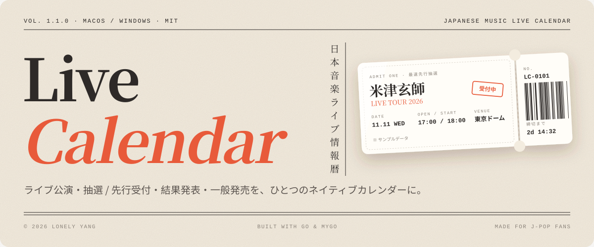

<p align="center">
  
</p>

<p align="center">
  <a href="#更新履歴"></a>
  <a href="LICENSE"></a>
  <a href="https://go.dev"></a>
  <a href="https://github.com/egoist/mygo"></a>
  <a href="#はじめに"></a>
  <a href="#はじめに"></a>
  <a href="https://github.com/Lonely0710/jpop-live-calendar/commits"></a>
  <a href="https://github.com/Lonely0710/jpop-live-calendar"></a>
  <a href="#データの方針"></a>
  <a href="#spotlight-icons"></a>
  <a href="https://github.com/Lonely0710/jpop-live-calendar/pulls"></a>
</p>

<p align="center">
  <a href="README.md">简体中文</a> · <b>日本語</b> · <a href="README.en.md">English</a>
</p>

Live Calendar は、日本の音楽ライブの公演、抽選・先行受付、結果発表、一般発売を公式の告知からひとつのカレンダーにまとめる、macOS / Windows 向けのネイティブデスクトップアプリです。


## 機能

<table>
<tr>
<td width="50%" valign="top">&nbsp;&nbsp;<code>01</code>&nbsp;<b>カレンダー</b><br><sub>月・週・日・リストの 4 表示。検索に加え、種類・ソース・地域・期間で絞り込めます。</sub></td>
<td width="50%" valign="top">&nbsp;&nbsp;<code>02</code>&nbsp;<b>チケット日程</b><br><sub>各受付、結果発表、一般発売を個別に表示し、カウントダウンと公式リンクを添えます。</sub></td>
</tr>
<tr>
<td width="50%" valign="top">&nbsp;&nbsp;<code>03</code>&nbsp;<b>地図</b><br><sub>都道府県ごとに公演数を集計。地域を選ぶと右側に公演を一覧表示します。</sub></td>
<td width="50%" valign="top">&nbsp;&nbsp;<code>04</code>&nbsp;<b>アーティスト</b><br><sub>ツアー・月別に公演を整理。ピン留め、ツアーの絞り込み、終了ツアーの非表示に対応。</sub></td>
</tr>
<tr>
<td width="50%" valign="top">&nbsp;&nbsp;<code>05</code>&nbsp;<b>出典の追跡</b><br><sub>出典の告知、公開日時、取得日時、版、解析に使ったテキストを確認できます。</sub></td>
<td width="50%" valign="top">&nbsp;&nbsp;<code>06</code>&nbsp;<b>変更履歴</b><br><sub>延期・中止・締切変更は履歴として残し、古いデータを上書きしません。</sub></td>
</tr>
<tr>
<td width="50%" valign="top">&nbsp;&nbsp;<code>07</code>&nbsp;<b>バックグラウンド動作</b><br><sub>メニューバー（macOS）/ タスクトレイ（Windows）で同期を続け、抽選締切の 3 日前に通知します。</sub></td>
<td width="50%" valign="top">&nbsp;&nbsp;<code>08</code>&nbsp;<b>ローカルスナップショット</b><br><sub>起動時は前回の結果を表示し、裏で更新。一部のソースが失敗しても他に影響しません。</sub></td>
</tr>
</table>

<p align="center">
  
</p>

<p align="center">
  
</p>

<p align="center"><sub>上の 2 枚はサンプルデータです。</sub></p>

## 画面

<table width="100%">
  <tr>
    <td width="50%" align="center" valign="top"><b><small>FIG. 1</small> 詳細パネル</b><br></td>
    <td width="50%" align="center" valign="top"><b><small>FIG. 2</small> 地図</b><br></td>
  </tr>
  <tr>
    <td width="50%" align="center" valign="top"><b><small>FIG. 3</small> アーティスト</b><br></td>
    <td width="50%" align="center" valign="top"><b><small>FIG. 4</small> ソース</b><br></td>
  </tr>
</table>

## データの方針

- **公開情報のみ**：公式サイト、RSS、Sony Music の公開 JSON から取得します。ログインせず、会員ページを読まず、チケットサイトもクロールしません。チケットのリンクは公式告知からのみ取得します。
- **節度あるクロール**：robots.txt（RFC 9309）に従い、同じサイトへは直列に、1 秒以上の間隔を空けてリクエストします。
- **推測しない**：未発表の時間や会場は「時間未発表」「会場未発表」と表示し、確信の持てない解析結果には「要確認」を付けます。

初期設定では 21 組のアーティストをフォローし、34 のソースが有効です。

## はじめに

| 必要なもの | バージョン |
| --- | --- |
| Go | 1.27 以上 |
| macOS | 13 以上（Apple Silicon / Intel） |
| Windows | 10 / 11 x64（macOS / Linux からクロスコンパイル可） |
| Xcode Command Line Tools | macOS でのパッケージ作成時 |
| NSIS | 任意（Windows インストーラー作成用） |

```bash
go mod download
go tool mygo dev                  # 開発モード（保存すると自動で再起動）
go test ./...                     # テスト
go vet ./... && go tool mygo vet .

scripts/package.sh darwin/arm64   # → build/jpop-live-calendar-darwin-arm64-<バージョン>.dmg
scripts/package.sh windows/amd64  # → build/jpop-live-calendar-windows-amd64-<バージョン>.zip
```

Windows ではパッケージを展開して `Live Calendar.exe` を実行します。同じフォルダーのリソースファイルも残しておいてください。

## ショートカット

| 操作 | macOS | Windows |
| --- | --- | --- |
| 前へ / 次へ | ⌘← / ⌘→ | Ctrl+← / Ctrl+→ |
| 今日へ移動 | ⌘T | Ctrl+T |
| 月 / 週 / 日 / リスト | ⌘1 – ⌘4 | Ctrl+1 – Ctrl+4 |
| 今すぐ同期 | ⌘R | Ctrl+R |
| サイドバーの表示切替 | ⌃⌘S | Ctrl+Shift+S |
| 詳細パネルの表示切替 | ⌥⌘I | Ctrl+Alt+I |
| 戻る / 検索をクリア | Esc | Esc |

地図にフォーカスがあるとき：←/→ で地域を切り替え、+/− でズーム、0 で全国を表示します。ドラッグで移動、スクロールでズーム、ダブルクリックで拡大もできます。

## 設定

ソースとアーティストは `sources.yaml` で定義し、次の順に読み込みます。

1. 環境変数 `LIVE_CALENDAR_CONFIG`
2. ユーザーディレクトリ：macOS は `~/Library/Application Support/Live Calendar/`、Windows は `%AppData%\Live Calendar\`
3. カレントディレクトリの `config/sources.yaml`
4. アプリに組み込まれた初期設定

```yaml
sources:
  - id: my-band-live
    name: あるバンド公式 LIVE
    kind: website        # demo | rss | website | api
    layer: live          # live：スケジュールページ、news：告知ページ
    url: https://example.com/live/
    interval: 12h        # 0 は手動同期のみ
    artist: あるバンド    # 任意：ページをこのアーティストに紐付け

artists:
  - name: ステラリウム
    aliases: [Stellarium]
    color: "#3975AB"     # 任意：テーマカラー
```

すべての項目（`article` フィルター、`follow` / `feature` の正規表現、アバター設定など）は [`config/sources.yaml`](config/sources.yaml) のコメントを参照してください。アプリの「ソース」ページからも追加・無効化・削除でき、ファイルへ書き戻す際にコメントは保持されます。

## ディレクトリ構成

```
main.go              エントリーポイント：ウィンドウ、メニューバー / トレイ、バックグラウンド同期
config/              sources.yaml の読み込み・検証・書き戻し
internal/
  sources/ crawler/  ソースアダプターと robots.txt 対応クローラー
  parser/ normalize/ 日本語告知の解析と正規化
  dedup/ catalog/    統合、変更履歴、メモリ上のスナップショット
  views/ theme/      UI とテーマ
  avatar/ cache/     アーティストのアバター、ローカル JSON スナップショット
  geo/               組み込みの都道府県地図データ
packages/spotlight-icons/  アイコンライブラリ（SVG 63 個）
scripts/package.sh   パッケージ作成スクリプト
```

## Spotlight Icons

本プロジェクト独自のアイコンセットです。24×24 の SVG を 63 個、6 グループに分け、線幅は 1.75–2、色は Spotlight テーマの 3 色のみ。メインモジュール内の通常パッケージなので、import するだけで使えます。

<p align="center">
  
</p>

```go
import (
	icons "jpop-live-calendar/packages/spotlight-icons"
	"jpop-live-calendar/packages/spotlight-icons/mygoicons"
)

mygoicons.Image(c, icons.Calendar, 18) // 元の色を保持（Ink Charcoal + Live Coral）
mygoicons.Mono(c, icons.Calendar, 18)  // 単色。文字色に追従
```

アイコンの追加・差し替え、定数の再生成の手順は [packages/spotlight-icons](packages/spotlight-icons/README.md) を参照してください。

## 既知の制限

- 解析ルールは日本語告知のよくある書き方のみに対応しています。正確な情報は原文を確認してください。
- 地図の精度は都道府県単位です。公演は会場の実際の位置ではなく、県庁所在地に表示されます。
- Windows 版のトレイ、通知、タイトルバーは実機で十分に検証できていません。

## 今後の予定

- チケット受付の解析を改善（例：「●エントリー期間」の次の行に日付がある告知）。
- 「ソース」ページで `article` フィルターと `follow` ルールを直接編集。
- カレンダーに中国・日本の祝日を表示（任意）。

## 更新履歴

- **1.0.2**（2026-10-23）：地図ページを追加。都道府県別に公演数を集計。
- **1.0.1**（2026-10-22）：Windows に対応。アーティストページをツアー別に整理。解析の不具合をいくつか修正。アイコンを 63 個に拡充。
- **1.0.0**：メニューバー常駐、締切通知、アプリ内でのソース追加、アバターのキャッシュ。
- **0.7.0**：ローカル JSON スナップショット。
- **0.6.0**：ソースをスケジュール層と告知層に分離。Sony Music の公開 JSON に対応。
- **0.5.0**：MyGo のネイティブコントロールに移行。サイドバーを折りたたみ可能に。
- **0.4.0**：Liquid Glass UI。アーティストのアバターとテーマカラー。

## ライセンスとクレジット

コードは [MIT](LICENSE) ライセンスで公開しています。地図データを商用利用する場合は国土地理院への報告が必要です。

<table align="center">
<tr><td align="right"><sub>作者</sub></td><td></td><td><a href="https://github.com/Lonely0710"><b>Lonely Yang</b></a></td></tr>
<tr><td align="right"><sub>ネイティブ UI フレームワーク</sub></td><td></td><td><a href="https://github.com/egoist/mygo"><b>MyGo</b></a></td></tr>
<tr><td align="right"><sub>言語</sub></td><td></td><td><a href="https://go.dev"><b>Go</b></a></td></tr>
<tr><td align="right"><sub>地図データ</sub></td><td></td><td><a href="https://www.gsi.go.jp/kankyochiri/gm_jpn.html"><b>地球地図日本（国土地理院）</b></a></td></tr>
<tr><td align="right"><sub>GeoJSON 変換</sub></td><td></td><td><a href="https://github.com/dataofjapan/land"><b>dataofjapan/land</b></a></td></tr>
<tr><td align="right"><sub>公開 JSON ソース</sub></td><td></td><td><a href="https://www.sonymusic.co.jp"><b>Sony Music</b></a></td></tr>
<tr><td align="right"><sub>アーティストのアバター</sub></td><td></td><td><a href="https://www.deezer.com"><b>Deezer API</b></a></td></tr>
<tr><td align="right"><sub>ホスティング</sub></td><td></td><td><a href="https://github.com"><b>GitHub</b></a></td></tr>
</table>
