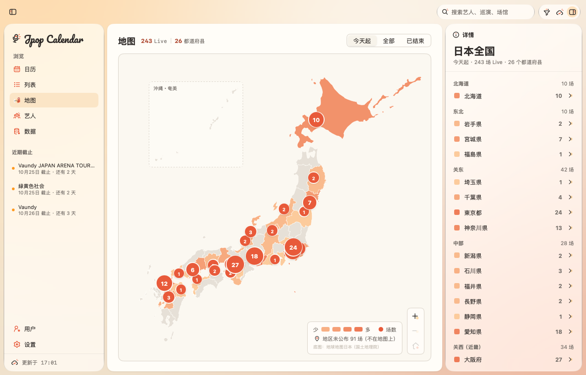
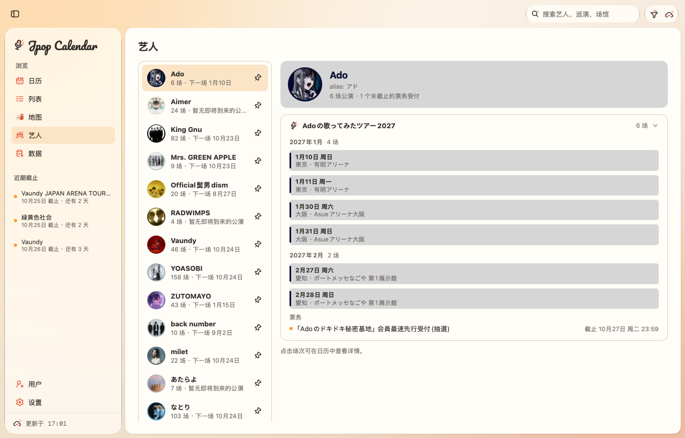
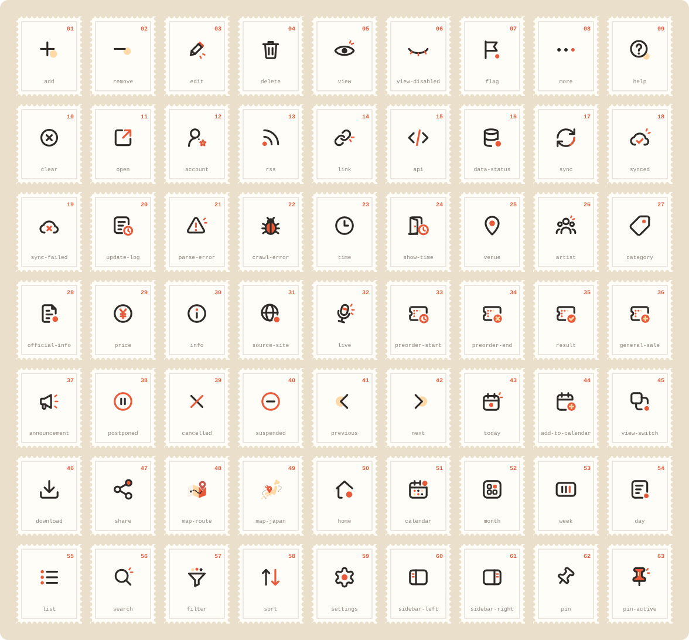

<p align="center">
  
</p>

<p align="center">
  <a href="#更新记录"></a>
  <a href="LICENSE"></a>
  <a href="https://go.dev"></a>
  <a href="https://github.com/egoist/mygo"></a>
  <a href="#快速开始"></a>
  <a href="#快速开始"></a>
  <a href="https://github.com/Lonely0710/jpop-live-calendar/commits"></a>
  <a href="https://github.com/Lonely0710/jpop-live-calendar"></a>
  <a href="#数据原则"></a>
  <a href="#spotlight-icons"></a>
  <a href="https://github.com/Lonely0710/jpop-live-calendar/pulls"></a>
</p>

<p align="center">
  <b>简体中文</b> · <a href="README.ja.md">日本語</a> · <a href="README.en.md">English</a>
</p>

Live Calendar 是一款 macOS / Windows 原生桌面应用，把日本音乐的 Live 场次、抽选 / 先行受付、结果公布和一般发售，从官方公告整理成一张日历。


## 功能

<table>
<tr>
<td width="50%" valign="top">&nbsp;&nbsp;<code>01</code>&nbsp;<b>日历</b><br><sub>月 / 周 / 日 / 列表四种视图，支持搜索，按类型、数据源、地区和日期筛选。</sub></td>
<td width="50%" valign="top">&nbsp;&nbsp;<code>02</code>&nbsp;<b>票务节点</b><br><sub>各轮受付、结果公布和一般发售分别显示，附倒计时和官方链接。</sub></td>
</tr>
<tr>
<td width="50%" valign="top">&nbsp;&nbsp;<code>03</code>&nbsp;<b>地图</b><br><sub>按都道府县统计 Live，点选地区后在右侧列出场次。</sub></td>
<td width="50%" valign="top">&nbsp;&nbsp;<code>04</code>&nbsp;<b>艺人</b><br><sub>按巡演和月份整理场次，可置顶、筛选巡演、隐藏已结束的巡演。</sub></td>
</tr>
<tr>
<td width="50%" valign="top">&nbsp;&nbsp;<code>05</code>&nbsp;<b>来源追溯</b><br><sub>查看来源公告、发布时间、抓取时间、版本和解析用文本。</sub></td>
<td width="50%" valign="top">&nbsp;&nbsp;<code>06</code>&nbsp;<b>变更记录</b><br><sub>延期、中止和截止时间变更都会留痕，不直接覆盖旧数据。</sub></td>
</tr>
<tr>
<td width="50%" valign="top">&nbsp;&nbsp;<code>07</code>&nbsp;<b>后台运行</b><br><sub>菜单栏（macOS）/ 系统托盘（Windows）常驻同步，抽选截止前 3 天通知。</sub></td>
<td width="50%" valign="top">&nbsp;&nbsp;<code>08</code>&nbsp;<b>本地快照</b><br><sub>启动时先显示上次结果再后台更新；单个数据源出错互不影响。</sub></td>
</tr>
</table>

<p align="center">
  
</p>

<p align="center">
  
</p>

<p align="center"><sub>以上两图为示例数据，仅作展示。</sub></p>

## 界面

<table width="100%">
  <tr>
    <td width="50%" align="center" valign="top"><b><small>FIG. 1</small> 详情面板</b><br></td>
    <td width="50%" align="center" valign="top"><b><small>FIG. 2</small> 地图</b><br></td>
  </tr>
  <tr>
    <td width="50%" align="center" valign="top"><b><small>FIG. 3</small> 艺人</b><br></td>
    <td width="50%" align="center" valign="top"><b><small>FIG. 4</small> 数据源</b><br></td>
  </tr>
</table>

## 数据原则

- **只用公开信息**：数据来自官网、RSS 和 Sony Music 公开 JSON；不登录，不读取会员页，不爬取票务平台，票务链接只从官方公告中获取。
- **礼貌抓取**：遵守 robots.txt（RFC 9309）；对同一站点串行请求，间隔至少 1 秒。
- **不猜测**：未公布的时间或场地如实显示为「时间未公布」或「场地未公布」，没有把握的解析结果标为「需确认」。

默认关注 21 位艺人，启用 34 个数据源。

## 快速开始

| 依赖 | 版本 |
| --- | --- |
| Go | 1.27+ |
| macOS | 13+（Apple Silicon / Intel） |
| Windows | 10 / 11 x64，可在 macOS / Linux 上交叉编译 |
| Xcode Command Line Tools | 在 macOS 上打包时需要 |
| NSIS | 可选，用于生成 Windows 安装程序 |

```bash
go mod download
go tool mygo dev                  # 开发模式，保存后自动重启
go test ./...                     # 测试
go vet ./... && go tool mygo vet .

scripts/package.sh darwin/arm64   # → build/jpop-live-calendar-darwin-arm64-<版本>.dmg
scripts/package.sh windows/amd64  # → build/jpop-live-calendar-windows-amd64-<版本>.zip
```

Windows 安装包解压后运行 `Live Calendar.exe`，同目录下的资源文件需一并保留。

## 快捷键

| 操作 | macOS | Windows |
| --- | --- | --- |
| 上一页 / 下一页 | ⌘← / ⌘→ | Ctrl+← / Ctrl+→ |
| 回到今天 | ⌘T | Ctrl+T |
| 切换月 / 周 / 日 / 列表 | ⌘1 – ⌘4 | Ctrl+1 – Ctrl+4 |
| 立即同步 | ⌘R | Ctrl+R |
| 显示 / 隐藏侧边栏 | ⌃⌘S | Ctrl+Shift+S |
| 显示 / 隐藏详情面板 | ⌥⌘I | Ctrl+Alt+I |
| 返回上一级 / 清空搜索 | Esc | Esc |

地图获得焦点时：←/→ 切换地区，+/− 缩放，0 显示全国。也可以用鼠标拖动、滚轮缩放、双击放大。

## 配置

数据源和艺人在 `sources.yaml` 中定义，按以下顺序读取：

1. 环境变量 `LIVE_CALENDAR_CONFIG`
2. 用户目录：macOS 为 `~/Library/Application Support/Live Calendar/`，Windows 为 `%AppData%\Live Calendar\`
3. 当前目录下的 `config/sources.yaml`
4. 编译进应用的默认配置

```yaml
sources:
  - id: my-band-live
    name: 某乐队官网 LIVE
    kind: website        # demo | rss | website | api
    layer: live          # live：日程页；news：公告页
    url: https://example.com/live/
    interval: 12h        # 0 表示只手动同步
    artist: 某乐队        # 可选：将页面固定归属到该艺人

artists:
  - name: ステラリウム
    aliases: [Stellarium]
    color: "#3975AB"     # 可选：主题色
```

完整字段（`article` 过滤、`follow` / `feature` 正则、头像设置等）见 [`config/sources.yaml`](config/sources.yaml) 的注释。也可以在应用的「数据源」页新增、停用或删除来源，写回文件时会保留注释。

## 项目结构

```
main.go              入口：窗口、菜单栏 / 托盘、后台同步
config/              sources.yaml 的加载、校验和写回
internal/
  sources/ crawler/  数据源适配器，以及遵守 robots.txt 的抓取器
  parser/ normalize/ 日文公告解析与规范化
  dedup/ catalog/    合并、变更记录、内存快照
  views/ theme/      界面与主题
  avatar/ cache/     艺人头像、本地 JSON 快照
  geo/               内嵌的都道府县地图数据
packages/spotlight-icons/  图标库（63 个 SVG）
scripts/package.sh   打包脚本
```

## Spotlight Icons

项目自带的图标库：63 个 24×24 SVG，分 6 组，线宽 1.75–2，只使用 Spotlight 主题的三种颜色。它是主 module 中的普通包，直接 import 即可使用。

<p align="center">
  
</p>

```go
import (
	icons "jpop-live-calendar/packages/spotlight-icons"
	"jpop-live-calendar/packages/spotlight-icons/mygoicons"
)

mygoicons.Image(c, icons.Calendar, 18) // 保留原色（Ink Charcoal + Live Coral）
mygoicons.Mono(c, icons.Calendar, 18)  // 单色，跟随文字颜色
```

新增或替换图标、重新生成常量的步骤见 [packages/spotlight-icons](packages/spotlight-icons/README.md)。

## 已知限制

- 解析规则只覆盖日文公告的常见写法，结果以原文为准。
- 地图只精确到都道府县，场次标在县厅所在地，而非场馆的实际位置。
- Windows 版的托盘、通知和标题栏尚未在真机上完整验证。

## 路线图

- 改进票务轮次的解析，例如日期写在「●エントリー期間」下一行的公告。
- 在「数据源」页直接编辑 `article` 过滤和 `follow` 规则。
- 在日历中显示中国和日本的节假日（可选）。

## 更新记录

- **1.0.2**（2026-10-23）：新增地图页，按都道府县统计 Live。
- **1.0.1**（2026-10-22）：支持 Windows；艺人页按巡演分组；修正若干解析问题；图标增至 63 个。
- **1.0.0**：菜单栏常驻、截止提醒、在应用内新增数据源、头像缓存。
- **0.7.0**：本地 JSON 快照。
- **0.6.0**：数据源分为日程层和公告层；接入 Sony Music 公开 JSON。
- **0.5.0**：改用 MyGo 原生控件；侧边栏可折叠。
- **0.4.0**：Liquid Glass 界面；艺人头像与主题色。

## 许可与致谢

代码以 [MIT](LICENSE) 许可证发布。地图数据商业用途须向国土地理院报告。

<table align="center">
<tr><td align="right"><sub>作者</sub></td><td></td><td><a href="https://github.com/Lonely0710"><b>Lonely Yang</b></a></td></tr>
<tr><td align="right"><sub>原生 UI 框架</sub></td><td></td><td><a href="https://github.com/egoist/mygo"><b>MyGo</b></a></td></tr>
<tr><td align="right"><sub>编程语言</sub></td><td></td><td><a href="https://go.dev"><b>Go</b></a></td></tr>
<tr><td align="right"><sub>地图数据</sub></td><td></td><td><a href="https://www.gsi.go.jp/kankyochiri/gm_jpn.html"><b>地球地图日本（国土地理院）</b></a></td></tr>
<tr><td align="right"><sub>GeoJSON 转换</sub></td><td></td><td><a href="https://github.com/dataofjapan/land"><b>dataofjapan/land</b></a></td></tr>
<tr><td align="right"><sub>公开 JSON 数据源</sub></td><td></td><td><a href="https://www.sonymusic.co.jp"><b>Sony Music</b></a></td></tr>
<tr><td align="right"><sub>艺人头像</sub></td><td></td><td><a href="https://www.deezer.com"><b>Deezer API</b></a></td></tr>
<tr><td align="right"><sub>代码托管</sub></td><td></td><td><a href="https://github.com"><b>GitHub</b></a></td></tr>
</table>
