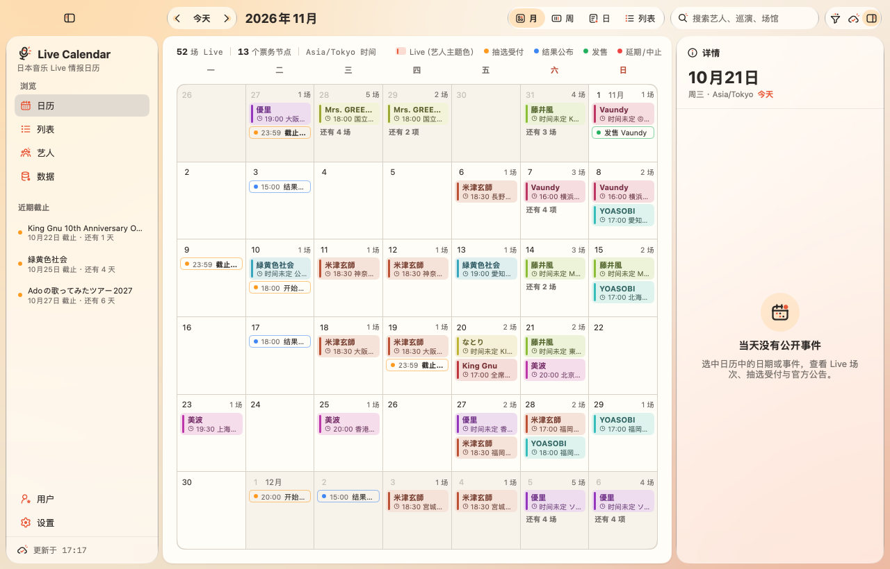
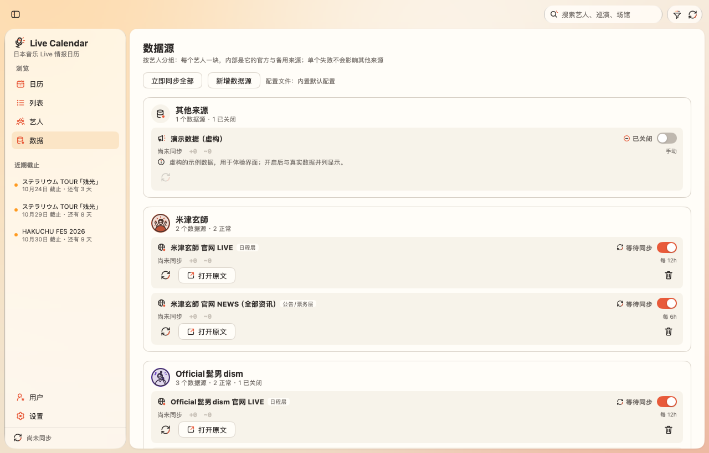
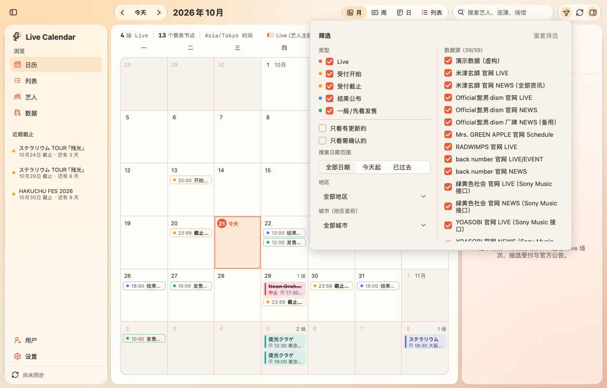
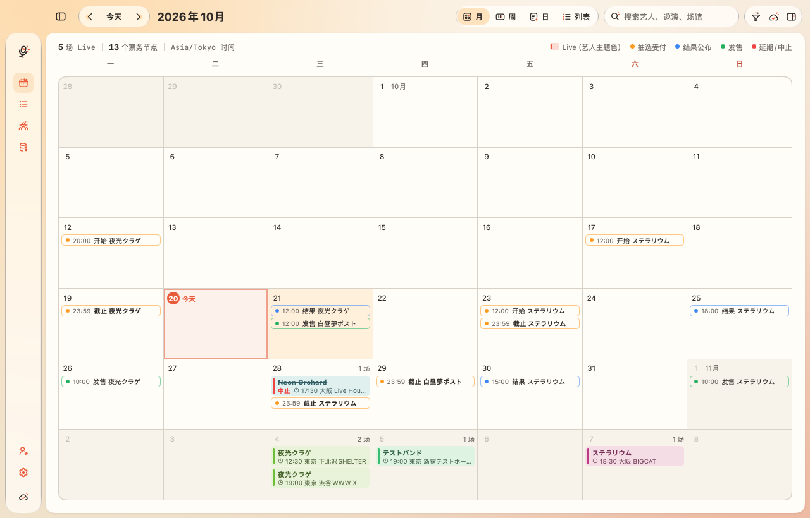

# Live Calendar · 日本音乐 Live 情报日历

macOS 原生桌面应用（**MyGo Native UI + Go**），把日本音乐的 Live、抽选 / 先行受付、结果公布、一般发售等**公开信息**整理成日历。

当前版本：**1.0.0 · Phase 1–5**。无数据库、无登录；公开公告保存在本地 JSON 快照中，启动时先显示上次同步的结果，再在后台同步。关闭窗口后留在菜单栏继续同步，抽选截止前 3 天用系统通知提醒，数据源可以在界面内新增。用户入口仅为占位。



---

## 如何启动

### 1. 环境要求

| 项目 | 版本 |
| --- | --- |
| macOS | 13+（Apple Silicon / Intel 均可） |
| Go | **1.27 或更高**（MyGo v0.5.5 要求 go 1.27） |
| Xcode Command Line Tools | 打包 `.app` / `.dmg` 时需要：`xcode-select --install` |

```bash
brew install go        # 或从 https://go.dev/dl/ 安装
go version             # 需显示 go1.27.x 或更高
```

### 2. 放置项目

```bash
mkdir -p /Users/lonely/Apps
unzip ~/Downloads/jpop-live-calendar.zip -d /Users/lonely/Apps/
cd /Users/lonely/Apps/jpop-live-calendar
```

### 3. 运行（开发模式）

```bash
go mod download        # 首次：下载 MyGo 等依赖
go tool mygo doctor    # 可选：检查本机环境
go tool mygo dev       # 编译并打开原生窗口，保存代码后自动重启
```

也可以直接 `go run .`。

### 4. 测试

```bash
go test ./...                                   # 单元测试
go vet ./... && go tool mygo vet                # 静态检查
```

### 5. 打包

```bash
go tool mygo build                              # → build/darwin-arm64/Live Calendar.app + .dmg
go tool mygo build -platform darwin/universal   # Apple Silicon + Intel 通用包
```

---

## 快捷键

| 快捷键 | 功能 |
| --- | --- |
| ⌘← / ⌘→ | 上一 / 下一个月（周、天） |
| ⌘T | 回到今天 |
| ⌘1 – ⌘4 | 月 / 周 / 日 / 列表视图 |
| ⌘R | 立即同步全部已启用的数据源 |
| Esc | 详情面板从事件返回当天列表 |
| ⌃⌘S | 显示 / 隐藏左侧边栏 |
| ⌥⌘I | 显示 / 隐藏右侧详情面板 |
| Esc（搜索框内） | 清空搜索 |

---

## 功能（Phase 1–5）

### 1.0.0 · Phase 5 正式版：菜单栏、截止提醒、界面内新增数据源

- **菜单栏常驻**：关闭窗口只是隐藏，App 继续在菜单栏和后台运行；点菜单栏图标或 Dock 图标重新打开，菜单里可以「立即同步」或「退出 Live Calendar」（⌘Q 同效）。这样锁屏 / 最小化之外，关掉窗口也不会中断定时同步。
- **抽选截止提醒**：启动后和每次同步完成时，检查未来 3 天内的受付截止，用 macOS 系统通知提醒（首次会请求授权）；同一截止只提醒一次（`notified.json`），截止时间延长时按新时间再提醒。点击通知会打开窗口并选中对应的截止条目；通知不可用（未授权、未打包）时只在设置页说明，不打扰。
- **界面内新增数据源**：数据源页的「新增数据源」表单可以填名称、类型（官网 / RSS）、层级、地址、艺人、同步间隔和备注；保存后写回 `sources.yaml`（内置配置写到用户配置目录，保留原有注释），立即同步一次，并可继续在卡片上停用或删除。不抓取票务平台，仍然只添加公开、允许访问的来源。
- **默认艺人头像**：没有头像、头像还没加载出来或只配置了主题色时，显示三张默认插画之一（吉他 / 舞台 / 主唱，按艺人 ID 稳定选择）。插画用艺人的主题色重新着色：浅色做脸和圆盘、深色做线条、主题色做乐器，线条对比度 ≥ 4.5:1。
- **头像磁盘缓存**：公开头像与主题色写入 `avatars.json`，启动先用缓存，再用 `ETag` / `Last-Modified` 条件请求检查；304 或图片字节没变就保留旧图，不重绘、不闪烁，只有真的更新才替换。
- **界面统一**：侧边栏选中项不再区分「有键盘焦点」和「没有」两种样式，统一为暖色底 + 珊瑚色图标；侧边栏悬停色与玻璃面板上的其他按钮一致，不再更深。
- **站点维护时不再误报**：robots.txt 返回 5xx 时按「暂时不可用（可能维护中）」提示，而不是笼统的「不允许抓取」；缓存从 24 小时缩短为 5 分钟，失败的数据源按 5 分钟 → 1 小时退避自动重试。头像加载失败也会在每次同步后及每 30 分钟重试，站点恢复后无需重启。
- **厂牌 NEWS 备用源（默认关闭）**：新增 `Official髭男dism 厂牌 NEWS（备用）` 与 `ヨルシカ 厂牌 NEWS（备用）`，只读 Pony Canyon / Universal 的官方厂牌 RSS；官方站维护时可在「数据源」页打开。它们只是新闻补充，不替代官方 LIVE 日程与抽选；RSS 适配器同时新增 `article.include`、`title_only`、`max_age`，避免把旧发布/上映新闻解析成假场次。
- **艺人页按巡演 / 月份分组**：有巡演名的场次按巡演分组；`Tour` 为空但多个场次标题相同的（如 `KING GNU LIVEHOUSE TOUR 2025 CLUB GNU EDITION`）按标题归成一个主题；一个主题跨多个月份时，内部再按月加「2026年4月 · N 场」小标题。即将到来的主题排在前面，旧单场演出沉到后面。
- **左上角 wordmark**：改为 `JPOP Calendar`，其中 `JPOP` 使用内嵌的 Pacifico 字体（`resources/Pacifico-Regular.ttf`，不依赖系统安装），`Calendar` 保持现有字体。
- **左右面板可拖拽调宽**：拖动侧边栏右边缘 / 详情面板左边缘，或在边缘聚焦后按 ← / →，即可调整宽度（侧边栏 180–340 DIP，详情 260–400 DIP）；折叠后仍保留宽度。侧边栏标题下的「日本音乐 Live 情报日历」副标题已移除。
- **筛选新增地区 / 城市**：按日本八个地区（北海道、东北、关东、中部、关西、中国、四国、九州冲绳）过滤，城市选项是各地区的首府（札幌、仙台、东京、名古屋、大阪、广岛、高松、福冈）；因为当前数据只有都道府县，城市筛选按首府所在都道府县匹配（例如「大阪」包含大阪府内的场馆）。
- **数据源按艺人分组**：每个艺人只占一块，块头显示艺人、来源数与正常/失败/关闭汇总，内部逐条列出官方与备用来源。层级（日程层 / 公告票务层）作为标签放在标题旁，同步间隔放在统计行右侧；每条只显示上次同步时间和 `+新增 / ~更新`，不再重复公告数、上次成功、官网 URL 和下次同步时间。同步、开关、打开原文、删除仍在每条来源上。

### 0.7.0 · Phase 4 收尾：本地缓存

- `internal/cache`：每次同步结束后，把读取到的**公开公告**写成一份带版本号的 JSON 快照（`~/Library/Application Support/Live Calendar/cache.json`，仍然没有数据库）。启动时先读回快照，重建场次 / 票务节点 / 变更记录，再在后台同步；重启不再从空日历开始，也能和上次的结果对比出变化。
- 公告按 URL 与版本保留：重启后 RSS 已读过的详情页直接复用缓存正文、不再抓取；官网列表页会重新读取（本次运行内的 `ETag` / `Last-Modified` 条件请求照常生效），已知公告不会重复入库。
- 写入是原子的（临时文件 + 替换）；版本不匹配时忽略旧快照，文件损坏时改名为 `cache.json.corrupt`，下次同步后自动重建。缓存只含公开信息，不含任何用户数据。
- **ヨルシカ 数据源修正**：只读官网 LIVE 分类 `/news/11/` 及其详情页；`/news/` 里的上映会、媒体掲載、Blu-ray 等公告不再按日程解析成假场次，`feature` 专题页也不再读取（旧专题页的场馆与时间分散在多行，会覆盖详情页正确的开演时间）。另修正 `OPEN / START：17:00 / 18:00` 全角冒号下把开场时间当开演时间的问题；文本归一化现在也处理兼容汉字（`⽇` → `日`）。

### 0.6.0 · 数据源重做 + 界面细节

**数据源（按《jp_live_sources_and_crawling_guide》重做）**
- **两层来源**：`layer: live` 官方 LIVE / SCHEDULE 列表（日程层，每 12 小时）+ `layer: news` 官方 NEWS / TICKET 公告（公告层，每 6 小时）。21 位艺人各配 1–2 个官方源，共 35 个，全部不登录、遵守 robots.txt、每站请求间隔 2 秒。
- **`kind: api` 已实现**：Sony Music 系官网（YOASOBI、優里、Aimer、なとり、milet、King Gnu、緑黄色社会）页面由 JS 渲染，改读页面自己加载的公开 JSON（Live 列表 + NEWS），不再整站关闭。
- **巡演专题页动态发现**：`feature`（正则）从已读的公告里找巡演特设页一并读取（如髭男 LIVE 列表为空时，由 NEWS 找到 ASIA TOUR 2026 专题页），不写死在配置里；不盲爬票务平台，票务链接只取自官方公告。
- **`article.exclude`**：公告层过滤グッズ / 配信リリース / 放送 / 雑誌 / Blu-ray / アプリ 等非 Live 公告。
- **解析修正**：巡演名从标题 / 正文取（「…」『…』“…”、【地区】标签、SOLD OUT 前缀）；修复 Mrs. GREEN APPLE 标题错误（现为 `Mrs. GREEN APPLE Ringo Jam Tour “SHADOWS”`）；「<埼玉>大宮ソニックシティ」写在日期上方的场馆；「17:00開場／18:00開演」；「<オフィシャル最速先行>」「■受付期間：」轮次；只有曜日的行；场馆里的 URL；日程页的帖子式写法；无标记的「日程・会場」段落标题；网站名标题（OFFICIAL SITE 等）改用链接文字。
- **ヨルシカ**：头像改用官网 `apple-touch-icon`；嘉宾出演公告（如「TK from 凛として時雨…にsuisがゲスト出演」）不再被当成本人的巡演；帖子日期与分类标签不再粘成 `2026.10.09suis` 这样的场次。
- 星野源官网没有日程列表，改读官方 **TICKET** 公告列表。



**界面**



1. 账户入口移到左侧边栏底部，点击弹出菜单。
2. 侧边栏 Live 图例改为与日历一致的色块。
3. 状态颜色统一（中止 / 延期 / 需确认）。
4. 详情面板去掉标题栏里的开关，工具栏右侧改为 Info 图标「详情」。
5. 重画「日」视图图标 `day.svg`。
6. 筛选面板改为两栏。
7. 日历里的 Live 条（liveChip）重新设计。
8. 日历顶部的统计总览改为等宽数字与分隔线，不再用「·」串成一句话。
9. 类型标签统一由 `kindLabel` 提供。
10. 工具栏胶囊加宽、按钮之间留出间距，选中的圆形缩为正圆，不再挤到相邻图标。
11. 侧边栏「数据源状态」更名为「数据」；数据源卡片与同步记录的时间、计数改用等宽字体。
12. 艺人可置顶：每行右侧的图钉（未选中 `pin`、选中 `pin-active`）把艺人排到最前；选择保存在本地 `pins.json`，不是账号收藏。
13. 同步进行时，工具栏与侧边栏底部的同步图标用 MyGo Motion（`Loop` + `Rotate`）持续旋转；系统开启“减少动态效果”时保持静止。
14. 点击工具栏的视图切换后，侧边栏对应项立即显示为选中；侧边栏没有键盘焦点时也使用与工具栏一致的暖色选中态，而不是 MyGo 默认的灰色。

### 0.5.0 · 界面调整



- **尽量使用 MyGo Native UI 自带控件**：侧边栏导航改用 `ui.Sidebar` / `ui.SidebarSection` / `ui.SidebarItem`（方向键切换、读屏软件可识别、失败数用 `ui.Badge`）；工具栏用 `ui.Toolbar`（Tab 一站、左右键切换、放不下时自动收进溢出菜单）；视图切换用 `ui.SegmentedBase`；侧边栏 / 详情面板开关用 `ui.ToggleBase`；「打开原文」用 `ui.Button` + 图标；来源公告、变更记录、解析用文本用 `ui.CollapsibleBase`；删除确认用 `ui.AlertDialog`。只有外观（玻璃胶囊、配色）是自己写的。
- 侧边栏第 2、3 项改名为 **列表**、**艺人**（页面标题同步改为「艺人」）。
- 非日历页面（艺人、数据源、设置）**铺满整个宽度**，右侧不再留空。
- 折叠左侧边栏后保留**图标栏**（类似 Codex App）：Logo、日历 / 列表 / 艺人 / 数据源图标（悬停显示名称），设置在底部，最下方是同步状态；图标与展开时位置一致。
- **侧边栏开关移到顶部标题栏**，紧挨红绿灯，不再放在左侧面板上。
- **工具栏与 macOS 红绿灯在同一行、垂直居中**：窗口用 `TrafficLightPosition` 把红绿灯放在 52pt 高的顶栏正中（之前 `TitleBarHeight` 在 macOS 上不生效，红绿灯停在默认位置）。
- 视图切换为「图标 + 文字」：月 / 周 / 日 / **列表**（不再显示 Agenda）。
- 详情面板：开场 / 开演用新图标 `show-time`；「打开原文」按钮带图标；复制链接用 `view-switch` 图标；来源公告与变更记录不再缩进；解析用文本用等宽字体。
- 数据源卡片第三行统一为：**艺人头像**（官网源；其他源显示类型图标）+ **同步**图标按钮 + **打开原文**按钮；右侧新增**删除数据源**（弹窗确认，内置演示数据不可删）。删除会写回 `sources.yaml`（使用内置配置时写到 `~/Library/Application Support/Live Calendar/sources.yaml`，下次启动即读取它），注释与其余内容保持原样。
- **移除 Skream! ニュース 数据源**（RSS 适配器仍保留，可自行添加允许转载的 RSS 源）。
- 图标库去重：删除同图不同名的图标，`official-site` → `link`、`agenda` → `list`，重画 `day` 与 `week` / `month` 统一；新增测试保证不会再出现重复图片。

### 0.4.0 · 界面改版
- **Liquid Glass 风格**：左右两个面板和工具栏胶囊按钮使用 MyGo 自带的 `plugins/glass` 玻璃材质（由 MyGo 自己的着色器绘制，不依赖 macOS 26，旧系统同样生效），背后是一层暖色渐变 + 柔光背景；日历本身放在不透明的白色卡片上，保证可读性。
- **两侧面板都可折叠**（带 250ms 动画）：顶栏按钮或 ⌃⌘S 折叠侧边栏，工具栏右侧按钮或 ⌥⌘I 折叠详情面板，详情面板标题栏也有关闭按钮。
- **搜索框**改用自己的图标库（`icons.Search` / `icons.Clear`），带清除按钮，Esc 清空。
- **艺人头像与主题色**：日历条、Agenda、详情面板、艺人页都显示艺人头像；每位艺人的主题色 = 头像中面积最大的色块。月视图的 Live 条为两行：艺人名（主题色）+「19:00 · 大阪 大阪城ホール」，每格显示「N 场」，放不下时显示「还有 N 场」，今天高亮并标「今天」。
- 「艺人 / 巡演」页列出 `sources.yaml` 里关注的全部艺人（还没找到公演的也会显示），再加上从公告中识别到的其他艺人。

### Phase 1 · 日历界面
- **月 / 周 / 日 / Agenda** 四种视图；⌘←/⌘→ 翻页，⌘T 回到今天。
- **Live 与票务节点一眼区分**：Live 是带色条的实心条；受付开始 / 截止、结果公布、发售是带圆点的描边胶囊，截止用粗体，中止加删除线，延期 / 中止标红。
- 周 / 日视图有「全天 / 时间未公布」一栏，没有公布时间的场次不会被放到某个猜测的钟点上。
- **搜索**（艺人、别名、巡演、场馆、城市、类型、来源），可限定「全部日期 / 今天起 / 已过去」。
- **筛选**：按类型（Live / 受付开始 / 受付截止 / 结果公布 / 发售）、按数据源、只看有更新的、只看需确认的。
- 选中事件 → 右侧 **Inspector**：日期、开场 / 开演、场地、类型状态、票务节点、变更记录、来源公告。
- 侧栏「近期截止」列出接下来的抽选截止及倒计时；「艺人 / 巡演」页按艺人→巡演整理场次与票务。

### Phase 2 · 真实公开数据源
- `config/sources.yaml` 配置数据源与艺人别名。默认接入艺人官网的 LIVE / SCHEDULE / NEWS 页；也支持 RSS / Atom 新闻源：标题含关键词（ツアー、ライブ、公演、チケット、先行…）的文章再打开原文页，只截取正文区域（0.5.0 起默认配置不再包含 Skream! ニュース）。
- 抓取器：自报 User-Agent、遵守 robots.txt（缓存 24 小时）、同一站点请求**串行且间隔 ≥ 1 秒**、ETag / Last-Modified 条件请求、失败重试与 Retry-After、Shift_JIS / EUC-JP 自动转码、单页 4 MB 上限。
- 每个数据源独立同步（单独超时、panic 隔离）：一个失败不影响其他，也不会清除已有数据；「数据源」页显示每个源的状态、公告数、上次成功、下次同步、错误与警告、同步记录，并可单独开关 / 同步。
- 解析：日文日期（含年份推断、曜日校验）、OPEN / START、都道府县 + 场馆、中止 / 延期 / 振替公演；结构化段落优先，只有正文句子时也能读出日期，但会标「需确认」。
- **缺失字段不猜测**：没写的时间显示「时间未公布」，没写的场地显示「场地未公布」，从标题推断的艺人名标「需确认」。
- 每条记录都能追溯到来源公告：发布 / 抓取时间、第几版、解析用文本、**打开原文**、复制原文链接。

### Phase 3 · 多公告合并与票务节点
- 同一场 Live 被多篇公告提到（巡演首发、后续公布开演时间、换写法的场馆名）→ 按「日期 + 艺人（含别名）+ 场馆」合并为一场；新公告补全的字段写入**变更记录**，不静默覆盖。
- 同一天同一艺人、不同场馆：时间不同视为两场（昼夜场）；无法判断时分开保存并互相标注「可能为同一场演出，需确认」。
- 票务轮次（オフィシャル最速先行、プレイガイド先行、FC 先行、一般発売…）独立成节点：**受付开始、受付截止、结果公布、一般 / 先着发售**分别出现在日历上，各自排序、各自有详情（倒计时、购票 / 受付链接、对应场次）。
- 截止延长等变化记入变更记录（如「受付截止 10-22 23:59 → 10-23 23:59」）；同一节点不会重复出现。
- 公告按 URL 去重，同一 URL 内容变化记为新版本；只有标题的条目不会覆盖已有正文。

> 实际情况：新闻稿多为「ツアー開催決定」+ 场次表，通常只写「チケットは〇〇にて販売中」，很少写抽选期间。抽选 / 结果 / 发售节点更多来自艺人官网的 LIVE / TICKET 页——可在 `sources.yaml` 里添加 `kind: website` 的源。内置的「演示数据（虚构）」覆盖了全部合并与票务场景，可在「设置」里关闭。

---

## 数据源配置：`config/sources.yaml`

读取顺序（找到即用）：环境变量 `LIVE_CALENDAR_CONFIG` → `~/Library/Application Support/Live Calendar/sources.yaml` → 当前目录 `config/sources.yaml` → 编译进 App 的默认副本。配置有误时 App 仍会用内置默认配置启动，并在「数据源」页显示错误。

```yaml
sources:
  - id: my-band-live            # 唯一 ID
    name: 某乐队官网 LIVE        # 显示名
    kind: website               # demo | rss | website | api（Sony Music 公开 JSON）
    layer: live                 # live = LIVE/SCHEDULE 日程层；news = NEWS/TICKET 公告层
    url: https://example.com/live/
    enabled: true
    interval: 12h               # 自动同步间隔，最小 10m；0 = 只手动同步
    artist: 某乐队              # 可选：页面一律归属该艺人（官网源）
    follow: '^https://example\.com/live/detail/\d+$'   # 可选：列表页 → 打开匹配的详情页
    feature: '^https://example\.com/feature/'          # 可选：从公告里发现的巡演专题页
    article:
      keywords: [ツアー, LIVE, 先行, 抽選]  # 链接文字含这些词才打开
      exclude: [グッズ, 配信リリース]       # 含这些词的不打开
      max_per_sync: 5
      delay: 2s

artists:
  - name: ステラリウム
    aliases: [Stellarium]       # 不同写法会合并成一个艺人
    official_url: https://example.com/  # 可选：官网
    avatar_url: https://example.com/a.jpg  # 可选：指定头像；填 none = 不用头像
    color: "#3975AB"            # 可选：指定主题色，优先于从头像取的颜色
    follow: true                # 默认 true：常驻「艺人」页；false = 只用于合并别名

avatars: deezer                 # deezer（默认）| off：不联网获取头像
```

**艺人头像与主题色**
- 头像通过 **Deezer 公开 API**（`api.deezer.com/search/artist`，无需账号）按艺人名查找，在后台下载，不阻塞界面；每秒最多 1 个请求。公开图片缓存在 `~/Library/Application Support/Live Calendar/avatars.json`，启动时先用缓存，再用 `ETag` / `Last-Modified` 条件请求检查更新，**只有图片真的变了才替换**；缓存只含公开图片与主题色，不含用户数据。`avatars: off` 可完全关闭；单个艺人可用 `avatar_url` 指定图片或填 `none`。
- 主题色算法：把头像像素分到 512 个色块（RGB 各 8 级），取像素最多的色块的平均色。若彩色像素占 10% 以上，就忽略近白 / 近黑（背景与阴影），否则保留（黑白照片会得到黑色）。条目文字颜色会自动调深 / 调浅，保证对比度 ≥ 4.5:1。
- 取不到头像时，用艺人名计算一个固定的颜色并显示默认插画。黑白照片、Logo 头像（如 King Gnu、美波）得到的是黑 / 灰色，想要更鲜明的颜色请用 `color` 覆盖。

**关于 robots.txt**：抓取官网与新闻站时遵守 robots.txt（RFC 9309），被禁止的路径不抓取，并在数据源说明里写明（例：『ユイカ』官网曾声明 `Disallow: /mob/`，目前其 robots.txt 返回 403——按 RFC 9309 视为不限制，但默认仍关闭该源，可在「数据源」页手动开启；开启后能解析 TOUR「Anemone」11 场 + FC / 官方受付）。Deezer 是 JSON API 而不是网页抓取，其 robots.txt（`Disallow: /*`）面向搜索引擎爬虫，所以头像查找不读取它，但仍限速并自报 User-Agent。

**默认关注的 21 位艺人与数据源覆盖**（2026-10-21 实测：34 个源全部同步成功，21 位艺人都有场次；数字为解析出的场次，“A + B”= 日程层 + 公告层，合并前）：

| 艺人 | 日程层（12h） | 公告层（6h） | 场次 |
| --- | --- | --- | --- |
| 米津玄師 | 官网 LIVE | 官网 NEWS | 16 + 28 |
| Official髭男dism | 官网 LIVE（当前为空） | 官网 NEWS → ASIA TOUR 2026 专题页 | 20 |
| Mrs. GREEN APPLE | 官网 LIVE | — | 9 |
| RADWIMPS | 官网 LIVE | — | 4 |
| back number | 官网 LIVE | 官网 NEWS | 9 + 4 |
| 緑黄色社会 | Sony JSON Live | Sony JSON NEWS | 13 + 1 |
| YOASOBI | Sony JSON Live | Sony JSON NEWS | 157 + 13 |
| 優里 | Sony JSON Live | Sony JSON NEWS | 6 + 33 |
| Aimer | Sony JSON Live + 15 周年专题 | Sony JSON NEWS | 24 |
| なとり | Sony JSON Live | Sony JSON NEWS | 88 + 39 |
| milet | Sony JSON Live | Sony JSON NEWS | 13 + 11 |
| King Gnu | Sony JSON Live | Sony JSON NEWS | 77 + 9 |
| 藤井風 | 官网 LIVE | 官网 NEWS | 24 + 11 |
| 星野源 | — | 官网 TICKET | 8 |
| Vaundy | 官网 LIVE | 官网 NEWS | 46 |
| Ado | 官网（SPA，已关闭） | Universal 官网 NEWS | 6 |
| ずっと真夜中でいいのに。 | 官网 LIVE | — | 44 |
| ヨルシカ | 官网 LIVE（仅 `/news/11/` 及详情页） | — | 18 |
| あたらよ | 官网 LIVE | — | 7 |
| 『ユイカ』 | — | 官网 NEWS（**默认关闭**，见 robots 说明） | 开启后 13 |
| 美波 | 官网 SCHEDULE | — | 21 |

失败或无数据的源会在「数据源」页显示原因（警告 / 错误 / 说明），不会静默消失。

`kind: rss` 可加 `article:` 段（`body_start` / `body_end` 截取正文、`keywords` 过滤、`include` 标题正则、`title_only` 忽略 feed 摘要、`max_age` 跳过旧条目、`max_per_sync`、`delay`），例如：

```yaml
  - id: my-news
    name: 某新闻站
    kind: rss
    url: https://news.example.com/index.xml
    enabled: true
    interval: 30m
    article:
      enabled: true
      body_start: '<div class="article-body">'
      body_end: '</article>'
      keywords: [ツアー, ライブ, 公演, ワンマン, チケット, 先行]
      include: '某艺人|Another Name'   # 可选：只保留标题匹配的条目
      title_only: true                  # 可选：先不读 feed 摘要，打开原文后才解析正文
      max_age: 90d                      # 可选：跳过 90 天前的旧条目
      max_per_sync: 15
      delay: 1s
```

官方站维护时，可在「数据源」页手动打开两个默认关闭的备用源：`Official髭男dism 厂牌 NEWS（备用）` 和 `ヨルシカ 厂牌 NEWS（备用）`。它们只读厂牌 RSS，**不替代官方 LIVE 日程与抽选**；`title_only` + `max_age` 用来避免把旧发布/上映新闻解析成假场次。

也可以在「数据源」页删除数据源（会写回配置文件）。

**数据原则**：只接入公开、官方或允许转载的信息源，遵守各站的使用条款与 robots.txt；App 只保存解析所需的文本，界面始终提供原文链接。

---

## 目录结构

```
jpop-live-calendar/
├── main.go                    # 入口：创建 macOS 窗口
├── go.mod / go.sum            # 依赖（MyGo v0.5.5）
├── mygo.json                  # 应用名、Bundle ID、版本、输出目录
├── resources/icon.png         # 应用图标（1024×1024，源文件 icon.svg）
├── config/                    # sources.yaml（数据源 + 艺人别名）与加载 / 校验
├── internal/
│   ├── domain/                # 公开数据模型：PublicEvent / Ticket / Artist / Venue / SourceConfig / SyncRun，Date 工具
│   ├── theme/                 # Spotlight 颜色、玻璃材质色、艺人配色（对比度计算）、布局尺寸
│   ├── avatar/                # 艺人头像（Deezer 公开 API）+ 主题色提取、条件更新
│   ├── views/                 # 全部界面：app / chrome(侧栏+工具栏) / calendar / inspector / pages
│   ├── sources/               # 数据源适配器：demo / rss(RSS2·RDF·Atom) / website / api(Sony Music JSON)
│   ├── crawler/               # 礼貌抓取器（robots、限速、条件请求、转码）+ 每源隔离的调度器
│   ├── parser/                # 日文公告 → 场次 / 票务轮次（不猜测缺失字段）
│   ├── normalize/             # 日期、时刻、都道府县、艺人别名、ID
│   ├── dedup/                 # 公告存储（URL 去重 / 版本）+ 合并为场次与票务节点 + 日历条目
│   ├── catalog/               # 线程安全的内存库，界面每帧读取不可变快照
│   └── cache/                 # 本地 JSON 快照：公开公告 + 公开头像（带版本号、损坏恢复）
├── packages/spotlight-icons/  # 图标库（主 module 内的普通包，见下）
├── docs/screenshots/          # 预览图
└── .agents/skills/            # MyGo 官方模板附带的 AI 编码说明
```

---

## 图标库：`packages/spotlight-icons`

图标库是本项目**主 module 里的普通包**，直接 import 即可，不需要额外下载或发布：

> 0.3.0 及以前的 `go.mod` 里有一行 `github.com/lonely/spotlight-icons v0.0.0`：那是我为图标库起的占位模块名，配合 `replace` 指向本地目录，**从未发布到 GitHub**，`v0.0.0` 也只是占位版本号。0.4.0 起已并入主 module，`go.mod` 里不再有这一项。

```go
import (
	icons "jpop-live-calendar/packages/spotlight-icons"
	"jpop-live-calendar/packages/spotlight-icons/mygoicons"
)

mygoicons.Image(c, icons.Calendar, 18) // 保留原色（Ink Charcoal + Live Coral）
mygoicons.Mono(c, icons.Calendar, 18)  // 单色，跟随文字颜色
```

> 说明：MyGo 的 `ui.Icon` 会把 SVG 统一染成文字颜色，所以双色图标用 `ui.Image` 绘制，`mygoicons.Image` 已封装好。

以后如果想把图标库单独发布给别的项目用，见 [packages/spotlight-icons/README.md](packages/spotlight-icons/README.md)。

---

## 已知限制

- 解析基于规则，覆盖日文新闻稿的常见写法；没把握的内容一律标「需确认」，请以原文为准。
- 数据保存在本地 JSON 快照（`cache.json` / `avatars.json`，都在 `~/Library/Application Support/Live Calendar/`）；删除它们只会让下次启动重新同步 / 重新下载，不影响数据源配置。
- 界面已通过截图验证；首次在 Mac 上运行时如有显示问题，欢迎反馈截图。

## 后续（Phase 5 之后）

- （可选）日历格子里显示中国 / 日本节假日（如「中·休 国庆节」「日·祝 スポーツの日」）。
- 票务轮次解析继续加强（如「●エントリー期間」下一行才写日期的写法）。
- 新增数据源表单支持 `article` 过滤与 `follow` 正则（现在这些仍可直接编辑 `sources.yaml`）。

